<h1 align="center">agent-readiness</h1>

<p align="center">
  <a href="https://github.com/itaides/agent-readiness/blob/main/LICENSE"></a>
  
  
  
</p>

<p align="center">
  
</p>

<h2 align="center">Check whether your site is ready for AI agents. From localhost.</h2>

<p align="center"><em>Public agent-readiness signals, plus local, CI, browser, and commerce probes — before you ship.</em></p>

The public agent-readiness tools only see what's on the open internet. That rules out `http://localhost:3000`, your staging deploy behind a VPN, your CI preview, and every PR before it merges — exactly when fixing things is cheap. `agent-readiness` is a small CLI you point at any URL you can reach.

```
$ agent-readiness https://example.com
agent-readiness  https://example.com/
scanned          2026-05-20T07:31:09Z

[discoverability] 3/3 passing
  PASS  robots.txt — Valid robots.txt with 11 User-agent group(s)
  PASS  sitemap.xml — Valid sitemap (well-known)
  PASS  Link header advertising api-catalog — Link header advertises api-catalog
  WARN  DNS for AI Discovery (DNS-AID draft) — No DNS-AID index; DNSSEC unknown

[content] 1/1 passing
  PASS  Markdown content negotiation — Server returns text/markdown for Accept: text/markdown

[bot-access] 2/3 passing
  PASS  Content Signals policy — Valid policy: ai-train=no, search=yes
  PASS  AI bot rules in robots.txt — Rules present for: GPTBot, ClaudeBot, ...
  PASS  Bot policy matrix (Search / Agent / Training) — Search=...; Agent=...; Training=...
  FAIL  Web Bot Auth public key directory — 200 but content-type "text/html" — looks like SPA fallthrough
```

---

## Install

The repo is private for now. Clone and link:

```sh
git clone git@github.com:itaides/agent-readiness.git
cd agent-readiness
bun install
bun link
agent-readiness https://example.com
```

When the repo flips public, the one-liner becomes:

```sh
bun install -g github:itaides/agent-readiness
```

Scanning a local dev server (HTTPS with self-signed cert, RFC1918, IPv6 loopback — all handled):

```sh
agent-readiness http://localhost:3000
```

---

## What it checks

23 checks across 5 categories, with unstable or runtime-dependent standards kept informational. Full pass criteria, endpoints, scoring rules, and spec references live in [`docs/checks.md`](docs/checks.md).

### Discoverability (4)
- `robots.txt` ([RFC 9309](https://datatracker.ietf.org/doc/html/rfc9309))
- `sitemap.xml` (with `robots.txt` fallback discovery)
- `Link` header advertising `rel="api-catalog"` ([RFC 8288](https://datatracker.ietf.org/doc/html/rfc8288))
- DNS-AID organization index (draft, informational)

### Content (2)
- Markdown content negotiation (`Accept: text/markdown`)
- `llms.txt` ([llmstxt.org](https://llmstxt.org/) — opt-in via `--include-llms-txt`)

### Bot access control (4)
- Content Signals in `robots.txt` and response headers (`ai-train`, `ai-input`, `search`, optional `use`)
- AI bot rules in `robots.txt` — looks for User-agent lines targeting GPTBot, ClaudeBot, PerplexityBot, Google-Extended, and 10 more
- Cloudflare-style Search / Agent / Training policy matrix (informational)
- Web Bot Auth key directory at `/.well-known/http-message-signatures-directory`

### Capabilities (10)
- A2A Agent Card at `/.well-known/agent-card.json`
- Agent Skills v0.2 index at `/.well-known/agent-skills/index.json`, with optional SHA-256 artifact verification
- API Catalog at `/.well-known/api-catalog` ([RFC 9727](https://datatracker.ietf.org/doc/html/rfc9727))
- OAuth Authorization Server Metadata ([RFC 8414](https://datatracker.ietf.org/doc/html/rfc8414))
- OAuth Protected Resource Metadata ([RFC 9728](https://datatracker.ietf.org/doc/html/rfc9728))
- MCP Server Card at `/.well-known/mcp/server-card.json`
- WebMCP (fetch-only heuristic, informational)
- `auth.md` agent registration guidance (opt-in, informational)
- MCP 2026-07-28 `server/discover` (explicit endpoint, informational)
- Lighthouse Agentic Browsing (opt-in, informational)

### Commerce (3, explicit scope)
- UCP discovery at `/.well-known/ucp`
- x402 v2 `PAYMENT-REQUIRED` challenge
- MPP `WWW-Authenticate: Payment` challenge

Commerce checks run only when you supply `--commerce-url`; they observe the initial 402 response and never pay. ACP and AP2 remain on the [`docs/roadmap.md`](docs/roadmap.md) watchlist until their external discovery criteria are stable.

Browser mode expects Lighthouse 13.3+ on `PATH` (for example, `npm install -g lighthouse`) and Chrome 150+; set `AGENT_READINESS_LIGHTHOUSE` to an explicit Lighthouse executable when needed.

---

## CLI

```
agent-readiness <url> [options]

  --preset all|content|api|commerce
                                Check group preset (default: all)
  --only id1,id2,...            Run only these check IDs (overrides --preset)
  --skip id1,id2,...            Skip these check IDs (applied after preset)
  --list-checks                 List every check and preset, then exit
  --include-llms-txt            Run the opt-in llms.txt check
  --include-auth-md             Run the API-focused auth.md check
  --content-url <url>           Page used for content and browser checks
  --commerce-url <url>          Paid resource used for UCP/x402/MPP checks
  --mcp-url <url>               MCP HTTP endpoint used for server/discover
  --browser                     Run Lighthouse Agentic Browsing
  --verify-skill-digests        Fetch and verify Agent Skills artifacts
  --baseline <report.json>      Exit 1 only for pass/fail regressions
  --format human|json|html|md   Output format (default: human)
  --timeout <ms>                Per-request timeout (default: 5000)
  --concurrency <n>             Parallel requests (default: 4)
  --insecure                    Skip TLS verification (auto-on for loopback/RFC1918)
  --user-agent <ua>             Spoof UA (e.g. "GPTBot/1.0")
  --header "K: V"               Inject a request header (repeatable)
  --cookie <value>              Send a Cookie header to the target
```

JSON output is pipeable and diffable:

```sh
agent-readiness https://example.com --format json | jq '.summary'
```

HTML output is a single self-contained file — inline CSS, no external assets, dark-mode-aware — ready to open in a browser, attach to a PR comment, or drop into a dashboard:

```sh
agent-readiness https://example.com --format html > report.html
open report.html
```

Markdown output works for PR bodies and Slack threads:

```sh
agent-readiness https://example.com --format md
```

---

## What makes this different

### Localhost works
The default scan uses HTTP and DNS signals and runs against `http://localhost:3000`, staging, and private networks. DNS-AID and commerce skip local/private targets. Browser execution is explicit via `--browser`.

### Strict response shape validation
SPA dev servers return `200 OK` + `text/html` for any path, including `/.well-known/*` paths that should be JSON. A naive scanner ("did we get 200?") reports these as passing. Every JSON check here validates the content-type **and** parses the body **and** checks required fields before claiming a pass. The same logic catches partial implementations in production — a real well-known endpoint serving JSON that's missing required fields fails for the right reason.

### Fast feedback
A default HTTP/DNS scan finishes quickly against a typical site. The core CLI remains a single-file ~80 KB JS bundle; Lighthouse is an optional runtime dependency used only by `--browser`.

### Regression-only CI gates
Save a JSON report, then use it as a baseline. Existing failures remain visible but do not break the build; a pass→fail transition or a newly introduced failure exits 1.

```sh
agent-readiness https://staging.example.com --format json > readiness-baseline.json
agent-readiness https://staging.example.com --baseline readiness-baseline.json
```

---

## Privacy

The tool has no analytics or telemetry. Default scans contact only the target origin plus its DNS resolver; explicit flags may load the content page in Chrome, contact a supplied MCP/commerce URL, or fetch skill artifact URLs advertised by the target. See [`PRIVACY.md`](PRIVACY.md).

The code in this repository is the code that runs on your machine. The core build artifact (`dist/cli.js`) is a single ~80 KB bundle.

---

## Security

Reporting a vulnerability: see [`SECURITY.md`](SECURITY.md). Findings about *target sites* you scan are between you and those site operators. Tool bugs (a false pass in shape validation, for example) — please report privately first.

---

## Develop

```sh
git clone git@github.com:itaides/agent-readiness.git
cd agent-readiness
bun install
bun test
bun run build       # dist/cli.js — single ~80 KB bundle
bun run typecheck
bun run audit:specs
```

Project layout:

```
src/
  cli.ts             # arg parsing + main()
  scanner.ts         # parallel check orchestrator
  http.ts            # fetch wrapper: timeout, redirects, body cap, insecure mode
  target.ts          # URL normalize + locality detection (loopback / RFC1918 / ULA)
  report.ts          # human + JSON formatters
  registry.ts        # check list + preset definitions
  types.ts           # Check, CheckResult, Target, HttpClient, Report
  checks/
    _shared.ts       # JSON well-known fetcher + shape validation helper
    *.ts             # one file per check (23 of them)
test/
  checks/*.test.ts   # per-check unit tests
  e2e.test.ts        # all checks against fixture-server
testdata/
  fixture-server.ts  # all-pass + SPA-fallthrough modes
docs/
  checks.md          # spec — pass criteria for every check
  roadmap.md         # stabilization queue + watchlist
prompts/             # copy-ready remediation prompts
scripts/
  audit-spec-staleness.ts
```

Adding a new check:
1. Add `src/checks/<id>.ts` with a default export of type `Check`.
2. Register it in `src/registry.ts`.
3. Document it in `docs/checks.md` with endpoint + pass criteria + spec URL + `asOf` date.
4. Add fixture data to `testdata/fixture-server.ts` for the all-pass case.
5. `bun test` should still pass.

---

## License

[MIT](LICENSE). Inspired by [isitagentready.com](https://isitagentready.com) and the [Cloudflare agent-readiness blog post](https://blog.cloudflare.com/agent-readiness/). Independent open-source implementation — not affiliated with Cloudflare.
